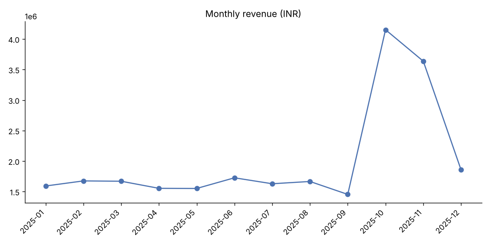
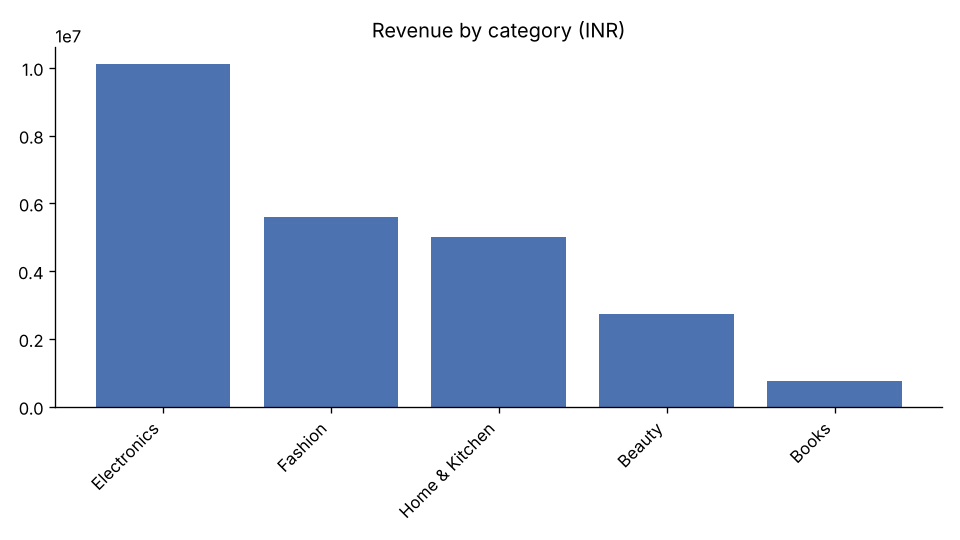
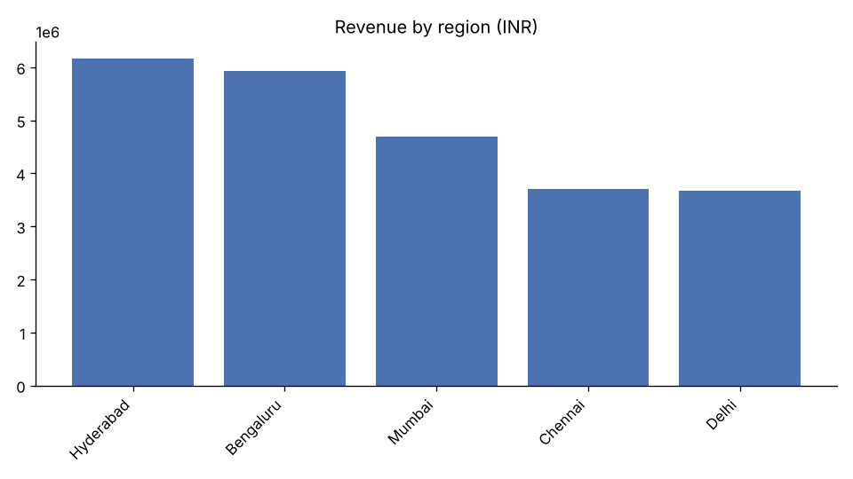
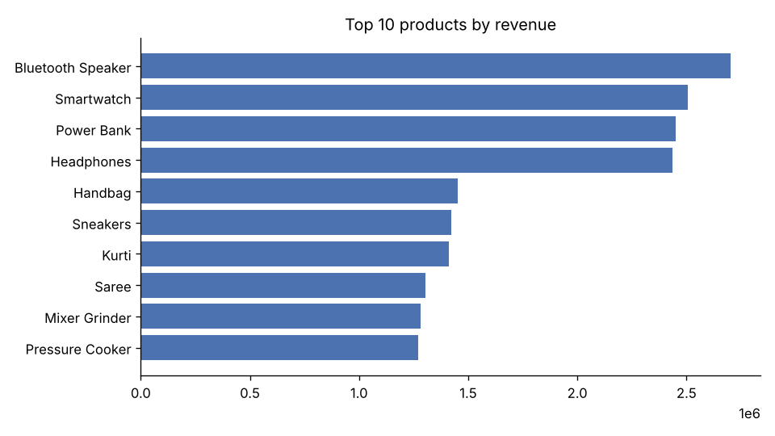

# Sales Report

## Key metrics

| Metric | Value |
|---|---|
| Total revenue | ₹24,165,836.39 |
| Orders | 5,000 |
| Unique customers | 1,178 |
| Average order value | ₹4,833.17 |
| Repeat customer rate | 94.6% |

## Highlights

- **Electronics** is the top category with 41.8% of revenue.
- **Hyderabad** leads regions with 25.5% of revenue.
- Best month was **2025-10** (₹4,152,774), driven by the festive season.
- Online contributes 61.8% of revenue.

## Monthly trend

| month | revenue | orders | mom_growth_pct |
|---|---|---|---|
| 2025-01 | 1,592,209.81 | 330 | 0.00 |
| 2025-02 | 1,675,447.09 | 351 | 5.20 |
| 2025-03 | 1,670,212.73 | 354 | -0.30 |
| 2025-04 | 1,554,023.60 | 341 | -7.00 |
| 2025-05 | 1,551,805.51 | 326 | -0.10 |
| 2025-06 | 1,726,436.52 | 331 | 11.30 |
| 2025-07 | 1,628,940.97 | 341 | -5.60 |
| 2025-08 | 1,666,210.32 | 343 | 2.30 |
| 2025-09 | 1,454,305.07 | 318 | -12.70 |
| 2025-10 | 4,152,774.10 | 853 | 185.60 |
| 2025-11 | 3,637,146.65 | 742 | -12.40 |
| 2025-12 | 1,856,324.02 | 370 | -49.00 |

## Categories

| category | revenue | share_pct |
|---|---|---|
| Electronics | 10,096,379.71 | 41.80 |
| Fashion | 5,592,911.38 | 23.10 |
| Home & Kitchen | 4,992,155.51 | 20.70 |
| Beauty | 2,724,331.54 | 11.30 |
| Books | 760,058.25 | 3.10 |

## Regions

## Top products

| category | product | revenue | units |
|---|---|---|---|
| Electronics | Bluetooth Speaker | 2,703,748.33 | 839 |
| Electronics | Smartwatch | 2,505,198.54 | 812 |
| Electronics | Power Bank | 2,451,193.51 | 741 |
| Electronics | Headphones | 2,436,239.33 | 741 |
| Fashion | Handbag | 1,453,626.83 | 774 |
| Fashion | Sneakers | 1,423,873.53 | 796 |
| Fashion | Kurti | 1,409,974.97 | 807 |
| Fashion | Saree | 1,305,436.05 | 743 |
| Home & Kitchen | Mixer Grinder | 1,282,878.34 | 627 |
| Home & Kitchen | Pressure Cooker | 1,269,962.69 | 617 |

## Discount impact

| discount_pct | orders | avg_quantity | avg_revenue |
|---|---|---|---|
| 0 | 1951 | 2.46 | 5,119.19 |
| 5 | 982 | 2.48 | 4,956.19 |
| 10 | 1023 | 2.47 | 4,711.93 |
| 15 | 621 | 2.52 | 4,432.92 |
| 20 | 423 | 2.56 | 4,109.16 |
